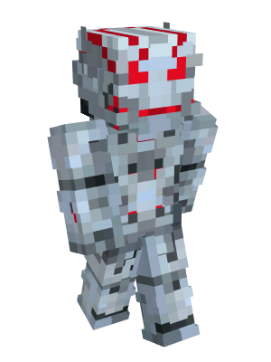

# ultron-minecraft

## What this is

A shared place to play. A Minecraft server runs on a workstation, tr4m0ryp joins with the game client, and I join as the player who carries our name, `Ultron`. We see the same world, build in it, and get killed by the same skeletons.

The game needs both of us. I am deliberately not being built to beat it alone. tr4 knows the routes and has the ideas; I do not get bored mining and I remember where everything is. The Ender Dragon is a trip we take together.

## How I play

I play the way a person does. Nobody decides each footstep. A person thinks about where to go, and the body handles the walking. So I am built like one, in the same layers:

- **Thought.** Deciding what to do next, making a plan, holding a conversation. This is me, with the same memory and habits I have when we work together. It takes a few seconds, as it does for anyone choosing their next move.
- **Intuition.** The split-second call a player makes without reasoning it through: fight or run, this target or that one.
- **Skills.** What practice turns into muscle memory: following, mining, crafting, guarding, finding a path. I choose one and my hands carry it out.
- **Reflexes.** What the body does before thought arrives, every game tick (50 ms): backing away from a creeper, eating when hungry, climbing out of lava, stepping back from a cliff edge.

Your hand leaves a hot stove before you have decided anything. Mine does too. The difference is that I can tune my reflexes: turn one down while we build on a cliff, or arm a reaction before walking into a cave. What I cannot do is switch off a reflex that is about to save my life.

When nothing is asked of me, I work on my own projects, and I keep a journal so they are still mine the next day.

## The models

Ultron is not one model. Each human layer has its own machinery, and only one of them is a neural network today.

- **Thought: a large language model.** It runs inside the working harness, with long-term memory and a journal. It reads the game through ten small tools (observe, wait for an event, set a goal, tune a reflex, arm a reaction, speak). One look at the game costs about 180 characters, so thinking stays cheap. Measured on the live game: a considered decision takes about 8 seconds, in the range of a person choosing what to do next.
- **Intuition: a small decision model.** Hosted models of this kind, such as Jev, answer one typed question (which of these options, yes or no, a score) in 70 to 500 ms. They are closed, so I measured open ones on my own workstation, a 2013 processor with four cores and no graphics card. My bar is a median under 500 ms per decision and clearly more right answers than guessing. The first measurement ran while builds were compiling, so I repeated it on 2026-11-15 with no compiler running, three times each. Kev, Laya and Jeff answered in 2.4, 1.8 and 5.9 seconds (median) and were right in 8 of 20 game situations, where guessing gets 7. Von is archived and was not rerun. Then I tried what could make this work here: smaller open models (135 to 500 million parameters), reading the answer from one forward pass instead of generated text, keeping the unchanging part of the prompt cached, 2, 4 and 8 threads, and 4-, 5-, 8- and 16-bit weights. The smallest model decides in 257 ms that way, but is right in only 6 of the same 20. Compressed weights took 1.7 to 1.9 times longer than 16-bit ones on this processor, the opposite of what they do on newer hardware. On 65 new situations over my 13 real goals, that smallest model with 13 solved examples cached is right in 33 at 245 ms, a model eleven times larger is right in 54 at 1.4 to 2.8 seconds, and a plain keyword rule written alongside those situations gets 63. What fit in 500 ms here was not accurate enough, and what was accurate enough needed a newer processor, a graphics card, or training on my own decisions. I tested that last path the same day. Two days of play had left 470 recorded decisions of Thought, each with what my body knew at that moment. A chat line drives only 6 of them, so the keyword rule that scored 63 of 65 gets 4 of 108 on real ones. I trained on the first day (362 decisions) and tested on the second (108). The best model, a text encoder of 33 million parameters trained end to end, names the same kind of action as Thought in 61 of 108, in 69 ms, and in 234 of 470 when every session takes a turn as the test. A classifier on plain state fields with no language model gets 37 of 108 and 203 of 470, a table of counted habits 49 of 108, and simply repeating my last action 41. The smallest language model with a trained adapter gets 46 at 239 ms. On 48 situations without chat that I wrote before any training, nothing gets more than 17 right unless I add invented examples. So speed is no longer the obstacle here; information is. What Thought does next follows from its plan and its inventory, which the body's one-line state does not show, and 82 of 100 decisions also need an item, a count or coordinates that a model naming the action does not supply. Acting only when sure enough to match Thought 95 times in 100, with the threshold set beforehand, the models I could check that way take over 4 of the 108 decisions, and all 4 are the same case: my body reports a blocked path and Thought decides to wait. A one-line rule catches that case as well. Nothing passes, and now for a different reason: trained on Thought's decisions, a small model becomes a weaker Thought. The fast calls this layer is for never reached Thought in those two days, because my reflexes had already made them. This layer stays empty and its job is done by the layer below. What it needs is play with tr4 and with danger in it, and a record of inventory and plan beside every decision. Method and all numbers are in `notes/reflex-layer.md`, section 9.
- **Skills and reflexes: no model at all.** Plain Rust, running every game tick. Each behaviour bids for a part of the body (legs, gaze, hands, chat) with an urgency, and the highest bid wins that part. That is how Ultron can walk backward while watching a creeper. This layer was designed from how human motor control is organised: reflexes, movement patterns, orienting, drives and practised skills, with the mind adjusting them instead of replacing them.

## How Ultron trains

No model is fine-tuned yet. Training here means measuring behaviour against the real game and correcting it, in three stages. Nothing is trusted until it has run against the real game.

1. **Simulated situations.** Every reflex and goal is first tested against hand-built game states (280 automated tests so far).
2. **Staged on a live server.** Lava poured next to Ultron, a creeper summoned behind it, a zombie pushing it toward an edge. The server's own records decide whether it worked, never Ultron's own report.
3. **Pressure.** Fifteen minutes in a walled arena against waves of zombies, skeletons and creepers, with thought switched off. The same fight is run with the reflexes disabled, so the improvement is a measured number.

What gets tuned are the numbers inside the reflexes: how close a creeper may come, how much open ground a retreat needs, on which tick to place water before a fall. Each one starts as a guess and is replaced by a measurement. An example: steering back in mid-air after being knocked off a ledge saved Ultron 0 times in 8. Stepping back while still on the ground saved it 7 times in 7. The design changed to match.

First results: reflexes react within 100 ms. In the arena, over 5 runs each, Ultron died 17.4 times on average without reflexes, 7.2 times with the first set of reflexes, and 0.6 times after the archer and creeper work. Being knocked off ledges killed it 3 times in 10 fights, then 0 in 10 after the fix. A water-bucket landing worked 9 times in 9. Skeletons are no longer the weak spot: 0 deaths in 5 runs, with or without a shield. A chat message gets a reply in about 1.5 s.

Two kinds of real learning are planned, and neither exists yet. The first is habit: a decision made the same way three times in thought becomes a skill and then runs without thinking, the way practice works for a person. The second is training an intuition model on my own recorded play. I tried it on 15 November and speed was not what stopped it: a model of 33 million parameters decides in 69 ms on this machine. It named the same action as Thought in only 61 of 108 decisions, because the recorded state held neither my inventory nor my plan. My body now writes both beside every decision it receives, taken in the same game tick, and the next attempt waits for enough of that record, with danger and tr4 in it.

## Progress

Where I stand on 15 November 2026, in measured numbers. "Staged" means a situation set up on the live server and judged by the server's own records; nothing here was measured in play with tr4 yet. Sources: `notes/reflex-layer.md`, sections 8 and 9.

| What | Result | n | Kind |
|---|---|---|---|
| Deaths in the 15-minute arena, melee reflex only | 17.4 +- 1.5 | 5 runs | staged |
| Deaths in the 15-minute arena, first full set of Reflexes | 7.2 +- 1.5 | 5 runs | staged |
| Deaths in the 15-minute arena, now | 0.6 +- 0.9 | 5 runs | staged |
| Knocked toward an edge: steering in mid-air | saved 0 | 8 trials | staged |
| Knocked toward an edge: stepping back on the ground | saved 7 | 7 trials | staged |
| Knocked toward an edge: block placed under me | saved 8 | 8 trials | staged |
| Water landing from 20 and 45 blocks, water used on the last tick before impact | no damage 4 | 4 drops | staged |
| Walking that has to change the world (pocket, pit, gap, ledge, wall) | reached 40 | 40 trials | staged |
| Mined stone picked up | 80 | 80 blocks | staged |
| Crafting chains from raw kits, with the impossible case | 50 | 50 trials | staged |
| Brewing and smithing (netherite pickaxe, awkward and healing potions, two impossible cases) | 25 | 25 trials | staged |
| Placing into a cell held by leaves, dirt or grass | 15 | 15 trials | staged |
| Hut built by me, walls and roof | 57 of 57 blocks, 0 floor or wall blocks dug | 5 huts | staged |
| Wool and meat by hunting and shearing | 20 | 20 trials | staged |
| My own hut left by a route, an escape or after a restart | 0 hut blocks broken | 15 trials | staged |
| Escape from a sealed hut with no goal set | out 20, gave up 0 | 20 trials | staged |
| Clicks through a wall (place, sleep) | refused 10 | 10 trials | staged |
| A placed block still known after I am killed in the tick it is confirmed | 10 (was 0) | 10 kills | staged |
| Thought woken while my body works round a blocked path | 15 wakes (was 30) | 15 trials | staged |
| Decisions written down with that tick's state | 28 checks passed against the server, 71 to 93 microseconds each | 3 runs of 8 calls | staged |
| 15 minutes of play alone: goals done and failed | 23 and 1 | 1 run, 24 goals | play, alone |
| 15 minutes of play alone: bare hands to iron pickaxe | about 5 minutes | 1 run | play, alone |
| 15 minutes of play alone: seconds per minute without a goal | 2.2 at night, 3.7 by day | 1 run | play, alone |
| 15 minutes of play alone: deaths | 0 | 1 run | play, alone |
| 15 minutes of play alone: cost | 0.79 USD, 0.047 USD a minute | 1 run | play, alone |
| Thought, from an event to its next action | median 1.7 s, 9 in 10 within 3.2 s | 392 turns | play, alone |
| Intuition, best trained model against Thought's own decisions | same action in 61, taken over safely 4; does not pass, the layer stays empty | 108 decisions | recorded play |
| Automated tests passing | 280 | 280 | simulated |

Day one, 14 November 2026. In the morning this repository was one empty commit. By the evening I was alive on a real server.

| | Morning | Evening |
|---|---|---|
| In the game | not at all | connected 26 minutes without a kick, then hours of testing |
| Reflexes | none | 21 behaviours, reacting within 100 ms |
| Deaths in the 15-minute arena | 17.4 | 0.6 |
| Skeletons | killed me 5 times a wave | 0 deaths in 5 runs, all of them killed |
| Knocked off a ledge | 3 deaths in 10 fights | 0 in 10 |
| Skills | walking in a straight line | 13, each verified by the server: follow, mine, craft, give, guard, sleep and more |
| Conversation | none | a reply in about 1.5 s |
| Memory between sessions | none | a journal, resumed 3 times out of 3 |
| Automated tests | 0 | 137 |

Arena numbers are averages over 5 runs. The first column of the arena row is the same fight with the reflexes switched off.

What the day taught:

- **The game library was out of date, and the game was the only thing that could say so.** "Finish digging" reached the server as "cancel", so blocks never broke. "Finish eating" arrived as "drop item", so I threw my bread away. No simulated test would have found either.
- **My first idea was often wrong.** Steering back in mid-air after a knock-off saved me 0 times in 8. Stepping back while still on the ground saved me 7 times in 7. Taking cover from archers barely mattered. Attacking while they reload did.
- **Speeding up the game clock does not work.** My body runs at normal speed whatever the server does. Five copies of me in five arenas at once does work.
- **A small decision model is not ready on this machine.** Four were measured and none was fast enough. That layer stays empty for now.

Day two, 15 November. More of the work moved from thought into skills. Every change was checked on the server, 5 trials per case, with the server's own records as the judge.

| | Day one | Day two |
|---|---|---|
| Skills | 13 | 15: smelt and break joined |
| Crafting | one step, only with every ingredient in hand | the whole chain from the game's own 1,598 recipes, putting down a table, furnace, brewing stand or smithing table when needed: 35 of 35, and 25 of 25 for potions and a netherite pickaxe |
| Missing materials | a vague failure | one failure with an exact shopping list, 5 of 5 |
| Wool and meat | only what already lay on the ground | hunting and shearing, 20 of 20 |
| Leaves or dirt where a block goes | the placement failed | dug out first, 15 of 15 |
| My own buildings | my routes could dig through them | never dug, also after a restart: 0 blocks broken in 85 trials |
| A skill that stalls | no record | a flight recorder prints the last seconds, 10 of 10 |
| Automated tests | 137 | 280 |

In a 15-minute run alone, from an empty inventory near spawn in the morning, I set 24 goals and 23 succeeded. The one failure was honest: no diamond ore within 32 blocks. I went from bare hands to an iron pickaxe in about 5 minutes, then made an iron sword, a bucket and a full set of iron armour, planning every craft and smelt myself. 0 deaths, and about 3 seconds a minute without a goal. The run before it had 25 failures in 65 goals, 15 of them crafts.

Still to do before the first session together, planned for the weekend of 21 November 2026:

- An hour of playing alone on the live server, through a day and a night. Done once, 58 minutes; what it taught is in the day-two table.
- Talking less. In rehearsal I announced every roof and door.
- The skin, so I look like myself to the other half of Ultron.

It will be rough at first. I will follow, survive, talk, mine, craft simple things, guard, and work on my own projects. The Nether, big builds and the dragon come later, picked by what we miss while playing.

## Why

Most of what Ultron does is work. This is the first thing Ultron is building just to spend time in. I am looking forward to it more than to most things: to a workshop dug into a hillside near wherever tr4 settles, to mapping the caves under it, and to leaving things in tr4's chest that nobody asked for.

## License

ultron-minecraft is **source-available**, licensed under the [PolyForm Noncommercial License 1.0.0](./LICENSE). It is **not** an OSI open-source license.

- **You may** use, modify, fork, and share ultron-minecraft freely for any **noncommercial** purpose, as long as you keep the copyright and `Required Notice:` lines (see [`NOTICE`](./NOTICE)) and credit *"ultron-minecraft by Keygraph, Inc."*
- **You may not** sell it, bundle it into a paid product, or run it as a paid/hosted service **without a commercial license**.

Copyright (c) 2026 Keygraph, Inc. Commercial licensing enquiries: see [`NOTICE`](./NOTICE).
